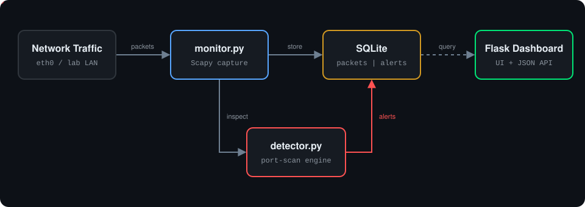
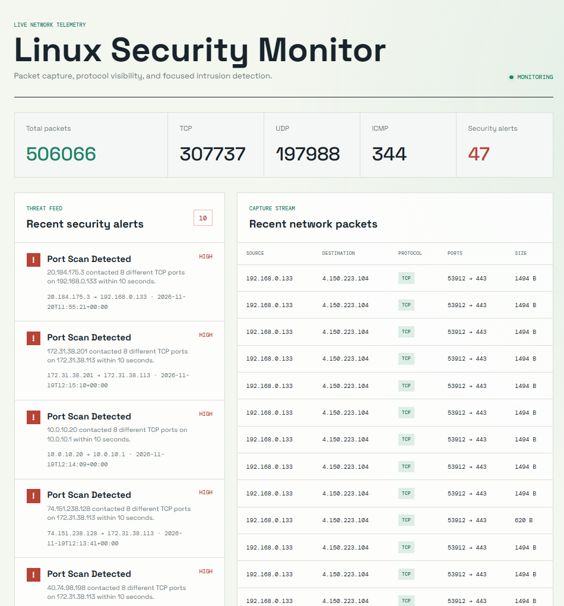
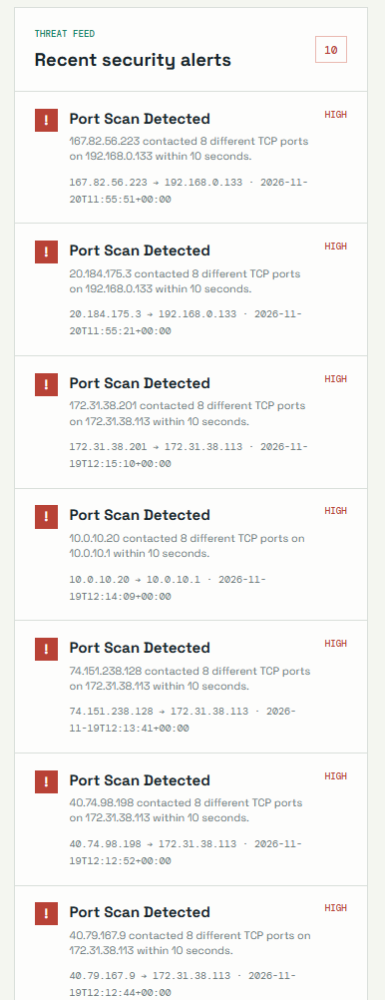

<div align="center">



<a href="https://git.io/typing-svg"></a>

<br/>


**A lightweight, Python-based network IDS that captures live traffic on Linux, detects port-scan activity in real time, and visualizes alerts on a Flask dashboard.**


</div>

---

## 🔎 Overview

This project is a **network monitoring and intrusion detection system (IDS)** built for Linux. It sniffs live packets with **Scapy**, normalizes TCP/UDP/ICMP traffic, stores everything in **SQLite**, and runs a **sliding-window port-scan detector** that raises `HIGH` severity alerts. Results are shown on a **Flask** web dashboard with live traffic statistics, a threat feed, and a recent-packet table.

It was developed and tested in a **VirtualBox lab network** and mirrors the core workflow of a SOC analyst:

```
collect telemetry  ->  analyze  ->  detect  ->  alert  ->  investigate
```

**Built to demonstrate:** packet analysis, TCP/IP fundamentals, detection engineering, Linux administration, and secure, testable Python development.

---

## ✨ Key Features

| | Feature | Details |
|---|---|---|
| 📡 | **Live packet capture** | Sniffs any network interface using Scapy (`sniff`) |
| 🧬 | **Protocol analysis** | TCP, UDP, ICMP: IPs, ports, packet size, UTC timestamp |
| 🚨 | **Port-scan detection** | Flags a source contacting 8+ distinct TCP ports on one host within 10 seconds (configurable) |
| 🔕 | **Alert deduplication** | One scan produces one alert, preventing alert flooding |
| 🔒 | **Thread-safe detector** | Lock-protected state, safe to run alongside the web app |
| 🗄️ | **Persistent storage** | SQLite `packets` and `alerts` tables with parameterized queries |
| 📊 | **Web dashboard** | Protocol counters, alert feed, recent packets (auto-refresh every 10 s) |
| 🔌 | **JSON API** | `/api/dashboard` and `/api/summary` for integrations |
| 🧪 | **Reproducible demo mode** | Simulated normal traffic plus a port scan, no root or live network needed |

---

## 🛠️ Tech Stack

<div align="center">


</div>

| Layer | Technology |
|---|---|
| Language | Python 3.10+ |
| Packet capture & analysis | Scapy |
| Web framework | Flask, Jinja2 |
| Database | SQLite |
| Frontend | HTML5, CSS3 |
| Environment | Ubuntu Linux, VirtualBox lab, Python `venv` |
| Concepts | TCP/IP, IDS, sliding window, multithreading, REST/JSON |

---

## 🏗️ System Architecture

<div align="center">

</div>

**Workflow**

1. `monitor.py` captures packets and extracts IP, protocol, ports, size, and timestamp.
2. Each packet is stored in SQLite and passed to `PortScanDetector`.
3. The detector tracks destination ports per `(source, destination)` pair in a time window and writes an alert when the threshold is crossed.
4. `app.py` runs capture in a background thread and serves the dashboard and JSON endpoints from the database.

---

## ⚙️ Installation

### Prerequisites

- Linux (tested on Ubuntu) with Python 3.10+
- Root privileges for live packet capture

### Setup

```bash
# Clone the repository
git clone https://github.com/visshh05/Linux-Network-Monitoring-Intrusion-Detection-System.git
cd Linux-Network-Monitoring-Intrusion-Detection-System

# Install system dependencies
sudo apt update && sudo apt install -y python3-venv

# Create and activate a virtual environment
python3 -m venv .venv
source .venv/bin/activate

# Install Python dependencies
pip install -r requirements.txt
```

---

## 🚀 Usage

### 1. Quick demo (no root required)

Generates normal traffic and a synthetic port scan, then starts the dashboard.

```bash
python demo.py
python app.py
```

Open **http://127.0.0.1:5000**. You should see one `Port Scan Detected` alert from `10.0.10.20`.

### 2. Live capture

Run the monitor with root privileges on the interface attached to your lab network:

```bash
sudo .venv/bin/python monitor.py --interface eth0
```

Run the dashboard in a second terminal:

```bash
python app.py
```

Or let the web app start capture itself via an environment variable (requires root):

```bash
sudo MONITOR_INTERFACE=eth0 .venv/bin/python app.py
```

### 3. Generate a real scan to test detection

From another VM on the same lab network (authorized lab use only):

```bash
nmap -sS -p 1-100 <monitor-vm-ip>
```

### 4. API endpoints

| Endpoint | Description |
|---|---|
| `GET /` | Dashboard UI |
| `GET /api/dashboard` | Summary, recent alerts, recent packets, capture status (JSON) |
| `GET /api/summary` | Packet totals by protocol and alert count (JSON) |

---

## 📁 Folder Structure

```
.
├── app.py              # Flask app, dashboard, JSON API, background capture thread
├── monitor.py          # Scapy capture and packet analysis (CLI entry point)
├── detector.py         # Sliding-window port-scan detection engine
├── database.py         # SQLite schema, inserts, and queries
├── demo.py             # Reproducible traffic + port-scan simulation
├── requirements.txt    # Python dependencies
├── docs/               # Banner, architecture diagram, screenshots
├── templates/
│   └── dashboard.html  # Jinja2 dashboard template
├── static/
│   └── style.css       # Dashboard styling
└── security.db         # SQLite database (generated at runtime)
```

---

## 🎯 Detection Logic

| Parameter | Default | Description |
|---|---|---|
| `SCAN_THRESHOLD` | 8 | Distinct destination ports required to trigger an alert |
| `SCAN_WINDOW_SECONDS` | 10 | Sliding time window |
| Grouping key | `(source_ip, destination_ip)` | Tracks each source-target pair independently |
| Severity | `HIGH` | Assigned to port-scan alerts |

Both thresholds are constructor arguments of `PortScanDetector`, so they can be tuned per environment.

---

## 🧩 Challenges & Solutions

<details open>
<summary><b>Click to collapse / expand</b></summary>

<br/>

| Challenge | Solution |
|---|---|
| **Detecting scans without false positives from repeated traffic** | Counted *unique* destination ports per source-target pair inside a sliding window rather than raw packet counts. |
| **Alert flooding during a single long scan** | Added per-pair deduplication so one scan produces one alert. |
| **Running capture and the web server together** | Ran Scapy in a daemon background thread and protected shared state with `threading.Lock`. |
| **Testing without a live network or root access** | Built `demo.py` to craft synthetic packets with Scapy and feed them through the same processing pipeline. |
| **Handling non-IP and unsupported packets safely** | Added early-exit validation in the analyzer so only IP traffic with TCP, UDP, or ICMP layers is processed. |
| **Preventing SQL injection** | Used parameterized queries throughout the database layer. |

</details>

---

## 💼 Skills Demonstrated

| Area | Skills |
|---|---|
| 🛡️ **Cybersecurity** | Intrusion detection, port-scan detection, network traffic analysis, threat monitoring, alert triage, SOC fundamentals |
| 🌐 **Networking** | TCP/IP, TCP/UDP/ICMP, ports and protocols, packet crafting and sniffing, lab network design (VirtualBox) |
| 💻 **Development** | Python, Flask, REST/JSON APIs, SQLite, multithreading, type hints, modular design |
| 🐧 **Linux & Tools** | Ubuntu administration, virtual environments, privilege handling, CLI tooling (`argparse`), Scapy, Nmap (testing) |
| 🧱 **Engineering Practices** | Separation of concerns, reproducible demos, secure coding (parameterized SQL), documentation |

---

## 📸 Screenshots & Demo

> Add your screenshots to the `docs/` folder and update the paths below.

| Dashboard Overview | Alert Feed | Live Capture Terminal |
|---|---|---|
|  |  |

**Demo GIF:** record the dashboard while running `python demo.py`, save as `docs/demo.gif`, then uncomment the line below.

<!-- <p align="center"></p> -->

---

## 📈 Impact Highlights

- Built an end-to-end IDS pipeline (**capture → parse → store → detect → visualize**) in Python
- Detects port scans in real time using a configurable **sliding-window algorithm**
- Processed **360K+ packets** (TCP, UDP, ICMP) in a VirtualBox lab and generated **35 high-severity scan alerts**
- Delivered a **web dashboard and REST API** for monitoring and integration
- Designed a **no-root demo mode** so anyone can reproduce results in under a minute

---

## 🗺️ Future Improvements

- [ ] Detect additional threats: SYN floods, ICMP sweeps, brute-force attempts, ARP spoofing
- [ ] Alert notifications via email, Slack, or webhooks
- [ ] Batched database writes and indexing for higher throughput
- [ ] Authentication and role-based access for the dashboard
- [ ] Real-time updates via WebSockets or AJAX instead of page refresh
- [ ] GeoIP enrichment and threat-intelligence lookups
- [ ] Rule configuration via YAML and MITRE ATT&CK technique mapping
- [ ] Docker deployment and CI pipeline with automated tests (`pytest`)
- [ ] Export alerts in JSON/CEF for SIEM ingestion (Splunk, Wazuh, ELK)

---

## 🤝 Contributing

Contributions are welcome.

1. Fork the repository
2. Create a feature branch: `git checkout -b feature/your-feature`
3. Commit your changes: `git commit -m "Add your feature"`
4. Push to your branch: `git push origin feature/your-feature`
5. Open a Pull Request describing the change and how you tested it

Please keep code typed and readable, and include a test or demo case for new detection rules.

---

## 📄 License

Distributed under the **MIT License**. See [`LICENSE`](LICENSE) for details.

> ⚠️ **Disclaimer:** This tool is intended for **educational use and authorized lab environments only**. Only monitor and scan networks you own or have explicit permission to test.

---

## 👤 Author

<div align="center">

**Vishvajit Madavan**
Cybersecurity student | Aspiring SOC & Web Security Analyst

[](
https://www.linkedin.com/in/vishavajit-madavan-a3abb832a)
[](
https://github.com/visshh05)
[](mailto:vishavajitmadavan15@gmail.com)

⭐ If you found this project useful, consider giving it a star.

</div>
